# Crawl manual

For the M-VAVE FM-1 · in the making: not yet run on an FM-1 ([README](README.md#status))

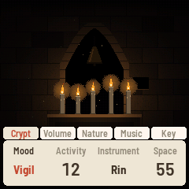

Every screen below is from the host simulator, which runs the firmware's own code. Try each thing as you read, in
the browser: **[keuller-clone.github.io/crawl/emu/](https://keuller-clone.github.io/crawl/emu/)**. The night
pictures are dark here, as the simulator draws them.

Contents: [1. The basics](#1-the-basics) · [2. The knob pages](#2-the-knob-pages) · [3. Moods](#3-moods) ·
[4. Crypt](#4-crypt) · [5. Forest Ruins](#5-forest-ruins) · [6. Frozen Lake](#6-frozen-lake) ·
[7. Night Sky](#7-night-sky) · [8. Long Night](#8-long-night) · [9. The buttons](#9-the-buttons) ·
[10. The keys](#10-the-keys) · [11. The koto instrument](#11-the-koto-instrument-hold-home) ·
[12. Everything at a glance](#12-everything-at-a-glance) · [13. Good to know](#13-good-to-know) ·
[14. In the browser](#14-in-the-browser)

---

## 1. The basics

Crawl plays by itself. A **scene** is a picture that moves, and what moves in it makes the notes. A **mood** is a
time and a character of that scene. You never need to touch anything; four controls are enough to find your way:

| Control | What it does |
|---|---|
| **PRESETS** knob | The scene: Crypt, Forest Ruins, Frozen Lake, Night Sky. The name shows as you turn; the scene changes when you stop |
| **ALGORITHM** knob | The mood. The first of every scene is Long Night |
| **MASTER** knob | The volume |
| **PLAY** button | A new picture of the same scene |

| Turning PRESETS | Turning ALGORITHM |
|---|---|
| 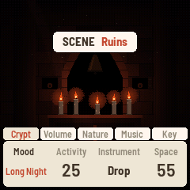 |  |
| The scene's name shows; here Crypt is about to give way to Ruins | The knob bar comes up on the scene's page with the new mood in red; it goes after three seconds |

The other knobs:

| Control | What it does |
|---|---|
| **SELECT** knob | Activity: how busy the scene is (flames, leaves, cracks or stars, and so how many notes) |
| **KNOB 1–4** | The four settings on the knob page that is showing ([2](#2-the-knob-pages)) |

**Knobs with a list** (Mood, Instrument, Voices, the Key page) go round past either end. **Knobs with a number**
stop at their ends, and turning quickly moves faster.

**Saving is automatic:** a change saves itself a little after you stop. Switch off any time; it comes back as you
left it.

A welcome card shows PRESETS, ALGORITHM, PLAY and FX the first time Crawl starts; touch anything to put it away.

---

## 2. The knob pages

**FX** shows the knob bar and steps through its five pages; **SEL** goes back a page. KNOB 1 to 4 turn the four
settings shown, left to right. The first page carries the scene's name.

| Scene page | Volume | Nature | Music | Key |
|---|---|---|---|---|
| 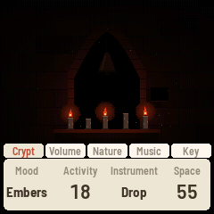 | 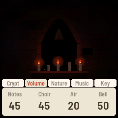 | 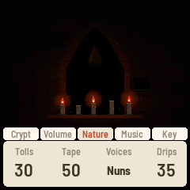 | 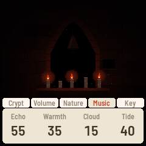 | 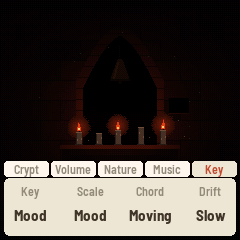 |

**The scene page** is the same in every scene:

| Knob | Setting | What it does |
|---|---|---|
| 1 | Mood | The same as ALGORITHM |
| 2 | Activity | The same as SELECT, 0 to 100 |
| 3 | Instrument | What plays the scene's notes: Drop, Mallet, Rin, Bell (Forest Ruins has Bamboo in place of Rin) |
| 4 | Space | The reverb |

**Volume, Nature and Music** differ by scene; each scene's section below shows its own. The settings they share:

| Setting | What it does |
|---|---|
| Notes | The volume of the scene's notes |
| Drone (Choir in Crypt) | The volume of the chord that breathes under everything |
| Air | The breeze |
| Voices | What sings the drone: Pad (no voice), Solo, Monks, Nuns, Cathedral |
| Echo | The tape echo |
| Warmth | Bright to mellow |
| Tape | Tape wear on the whole sound: wow, saturation, hiss |
| Tide | How much the music slowly swells and fades over minutes. At 0 it stays even |

**The Key page** is one setting for every mood and every scene. Each starts as the mood has it, so nothing changes
until you turn one.

| Knob | Setting | What it does |
|---|---|---|
| 1 | Key | Mood (the mood's own key), or C to B: the drone and every note center on that key |
| 2 | Scale | Mood (the mood's own dark scale), or Yo, In or Min'yo always. These three are ZEN-1's; Crawl's own scales are only reached through the moods |
| 3 | Chord | Moving (the drone's chord changes every few minutes) or Held (it stays on the home chord) |
| 4 | Drift | How often the key moves a fourth or a fifth at a dawn of Long Night: Off, Slow (every third) or Often (every one). **Off also holds Long Night in its scene** ([8](#8-long-night)) |

---

## 3. Moods

The Mood sets a scene's time and its whole character at once: its sounds, what makes the notes, its key and scale,
and something of its own to see. Changing it glides there over about thirty seconds; nothing jumps.

**Your tweaks:** turn any knob and the mood you are in keeps your setting, after a power-off too. A tweaked mood
has a small dot after its name, on the knob bar and on the HOME card. Every mood of every scene keeps its own.

**Reset a mood:** on the Mood knob, a tweaked mood is followed by "Reset" and its name. Leave the knob there for
two seconds and that mood goes back to how it was made.

---

## 4. Crypt

Five candles on a tomb, a bell in a niche, dust, water from the vault. A flame's gutter is a note; wax reaching a
candle's foot is a soft note; dust in a flame is a spark and a high note; the bell is struck metal on the chord's
root; a water drop is heard where it lands. Under them a choir breathes the chord.

| Vigil | Procession | Sealed | Embers |
|---|---|---|---|
| 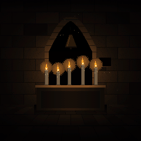 | 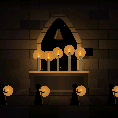 | 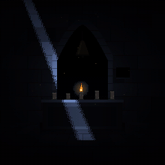 | 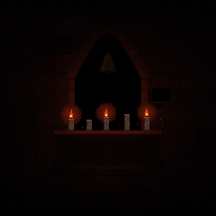 |
| Still. Monks, low; few notes; the bell seldom | A steady pace: a footfall every 1.1 s, three notes a bar on the candles in turn, hooded figures crossing with a candle each | One candle and a shaft of cold light. No voice; the water's drops as high notes in a long echo | Three candles burning red; nuns with a little breath; more tape |

| Volume | Nature | Music |
|---|---|---|
|  |  |  |
| Notes · Choir · Air · **Bell** (the bell's volume) | **Tolls** (how often the bell rings by itself; 0: never) · Tape · Voices · **Drips** (the water; 0: none) | Echo · Warmth · **Cloud** (a cloud of grains made from the sound) · Tide |

**Keys.** White keys: a note each, and the candle nearest it flares. Black keys, from the left: 1 to 5 snuff a
candle or light it again; 6 to 10 ring the bell, a note each; the top one sends a draught through the vault (the
flames lean and gutter).

| Two candles snuffed (black keys 1 and 2) | A new vault (PLAY) | Pixel art (GLO) |
|---|---|---|
| 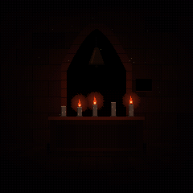 | 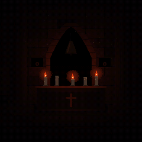 | 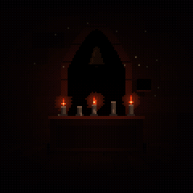 |

---

## 5. Forest Ruins

"Ruins" on the screen. A path to a misty vanishing point between redwoods, ferns, shafts of light; the ruin is a
hollow trunk, a log, a stump and stones. A leaf landing on the path is a note (in the ferns a touch); crows call
from where they sit or fly; wind through a hollow is a bowed string, one note a hollow; a fog bank is a swell;
lightning, then thunder, and the crows go up; a cone falls with a knock; at night bats and the owl.

| Dawn Mist | Overgrown | Storm | Owl Moon |
|---|---|---|---|
| 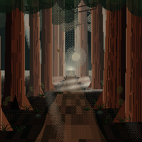 | 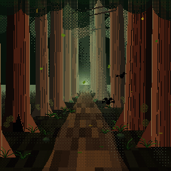 | 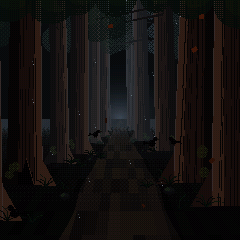 | 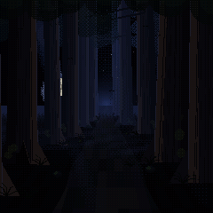 |
| Fog, a pale sun, swells, one far crow. A pad, no wind | The forest in leaf, leaves falling thick, three crows, a cathedral choir | Rain, the hollows singing without pause, lightning and thunder, crows wheeling | The moon and the stars, bats, falling cones, the owl, one hollow voice |

| Volume | Nature | Music |
|---|---|---|
| 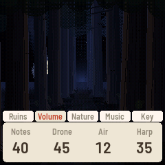 | 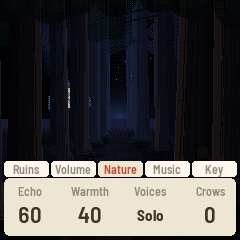 | 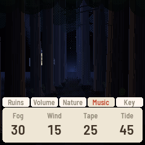 |
| Notes · Drone · Air · **Harp** (the hollows' singing) | Echo · Warmth · Voices · **Crows** (how often they call; 0: never) | **Fog** · **Wind** (the gusts) · Tape · Tide |

**Keys.** White keys: a note each, and a leaf lets go above it and falls. Black keys, from the left: 1 to 4 a
crow each calls (one that is not there calls from far off); 5 to 7 the hollow trunk, the log and the stump sing;
8 a gust; 9 a fog bank rolls in; 10 a cone falls; the top one is lightning.

| After lightning (the top black key), in Storm: the crows are up |
|---|
| 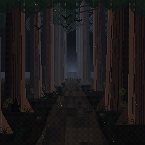 |

---

## 6. Frozen Lake

"Lake" on the screen. The lake from its shore, the ice running to a keep on a headland; reeds, two mooring posts,
often a boat frozen in. Cracks run across the ice and grow; the ice groans, a recording pitched to the chord's
root; the keep's bell tolls across the lake; a gust sings the reeds; meltwater drips; snow falls, and a flake on
the near ice is a faint touch.

| Grey Dawn | Thaw | Whiteout | Black Ice |
|---|---|---|---|
| 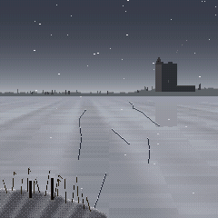 | 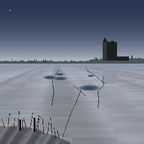 | 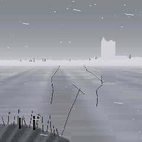 | 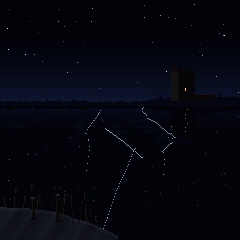 |
| Still. A pale band on the horizon, light snow, the bell on its time with a swell answering | Pools of meltwater holding the sky, drips and a trickle, cracks thick and fast and each a note. No snow, no bell | Everything far gone into the white, snow driven in streaks, each gust singing the reeds, the bell muffled | Night. The stars and the keep's lit window in the ice, groans, the whistle of far fractures, one voice, a long echo |

| Volume | Nature | Music |
|---|---|---|
| 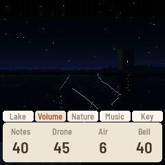 | 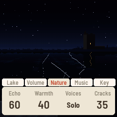 | 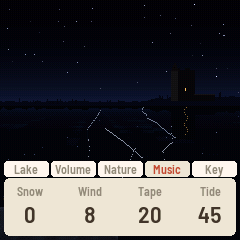 |
| Notes · Drone · Air · **Bell** (the keep's bell) | Echo · Warmth · Voices · **Cracks** (how often; 0: never) | **Snow** · **Wind** (the gusts) · Tape · Tide |

**Keys.** White keys: a note each, and a crack runs where it lands. Black keys, from the left: 1 to 3 a crack
near, in the middle, far; 4 the ice groans; 5 to 7 the keep's bell, one, two, three strokes; 8 a gust; 9 a drip;
10 a flurry; the top one is the ice giving (a groan, and the main crack runs its length).

| The ice giving (the top black key), in Thaw |
|---|
| 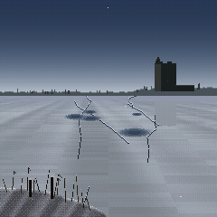 |

---

## 7. Night Sky

"Sky" on the screen. A moor under the sky, a ring of standing stones on the ridge, three pines. Each picture has
its own moon, of its own size and phase, on the path that phase really takes. A star that blinks is a note where
it stands; a star coming out at dusk is a soft note; a glint on a cold night is a chime; a meteor is a falling run
of chimes; the aurora's pulses are swells; a cloud over the moon darkens the sound; an eclipse brings a gong at
each contact and a far drum.

| Dusk | Cold Clear | Eclipse | Deep Night |
|---|---|---|---|
| 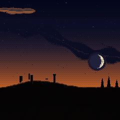 | 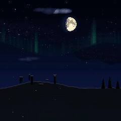 | 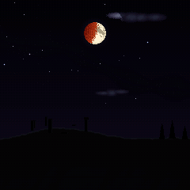 | 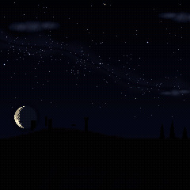 |
| The afterglow, clouds lit from below, a thin crescent setting, the stars coming out one by one, rooks going home | Every star out and glinting, the aurora in curtains, frost, a bright moon high, nuns | The full moon into the earth's shadow and out, copper in totality: the gong, the drum, monks, a long echo | Moonless and darkest, the Milky Way, a meteor shower, an old crescent rising late, one voice, the owl |

| Volume | Nature | Music |
|---|---|---|
| 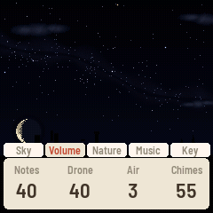 | 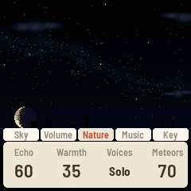 | 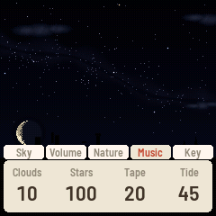 |
| Notes · Drone · Air · **Chimes** (the meteors and glints) | Echo · Warmth · Voices · **Meteors** (how often; 0: never) | **Clouds** · **Stars** (how many are out) · Tape · Tide |

**Keys.** White keys: a note each, and a star flares where it lands. Black keys, from the left: 1 and 2 a meteor,
west and east; 3 a fireball; 4 a cloud across the moon; 5 the aurora pulses; 6 the gong; 7 the drum, a roll;
8 an eclipse begins; 9 another moon (the phase turns); 10 the owl; the top one is a burst of meteors.

| A fireball (black key 3), in Deep Night |
|---|
| 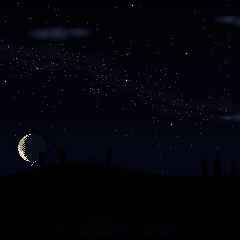 |

---

## 8. Long Night

The first mood of every scene. It is one night that passes from scene to scene:

- It holds a scene for **half an hour**, going through that scene's four moods in turn.
- Then the picture fades to dark over four seconds, the next scene comes up over four more, and the old scene's
  last notes ring out under the new one. The echo, the tape and the reverb carry across.
- The order is **Crypt, Night Sky, Forest Ruins, Frozen Lake**, two hours round, so each join reads forward:
  Sealed into Dusk, Deep Night into Dawn Mist, Owl Moon into Grey Dawn, Black Ice into Vigil.
- The night keeps one key from scene to scene; a pass is its dawn, when the key may move (the Key page's Drift).

Choosing a scene whose mood is Long Night enters the night there, somewhere in that scene's round. Turning the
Mood in a scene the night has passed into makes that scene yours: another mood ends the night there, Long Night
takes it up again from there. The sleep timer runs across the passes.

**To keep Long Night in one scene**, set **Drift** to Off on the Key page: the scene's own half-hour round then
goes on for good.

---

## 9. The buttons

| HOME (tap) | SEQ | ENV |
|---|---|---|
| 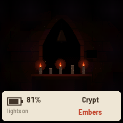 | 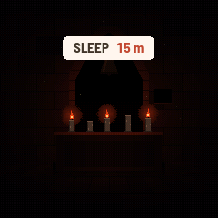 | 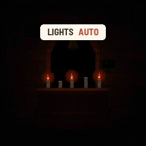 |

| Button | In a scene |
|---|---|
| **FX** | Show the knob pages, then the next page ([2](#2-the-knob-pages)) |
| **SEL** | The page before |
| **ENV** | The panel's lights: on, auto (out after 30 s untouched, back at a touch) or off (for a dark room; everything still works) |
| **GLO** | Painted look or pixel art |
| **PLAY** | A new picture: a new vault, path, shore, or moor and moon. It fades in, and the music keeps playing |
| **HOME** | Tap: the battery, the lights, the scene and the mood, for three seconds. Hold: the koto instrument ([11](#11-the-koto-instrument-hold-home)); hold again to come back |
| **SEQ** | The sleep timer: each press the next time (Off, 15 m, 30 m, 1 h, 2 h, 4 h, 8 h). The picture dims over the last ten minutes, then everything fades out over half a minute; any button or key wakes it, and that press only wakes it |
| **SAVE** | Tap: save now (it also saves by itself). Hold 3 seconds: reset everything to how it came; a countdown shows, let go to cancel |
| **OCT− · OCT+** | The scene's notes an octave down or up. On the FM-1, both held 5 s: update mode, for installing firmware |
| **LFO · EDIT · ARP · REC** | Not used in a scene |

---

## 10. The keys

**White keys** play notes that always fit the music, low on the left to high on the right, and the scene answers
each one. **Black keys** are each scene's own, counted 1 to 11 from the left.

| Scene | White keys | Black keys |
|---|---|---|
| Crypt | The candle nearest your note flares | 1–5 snuff or light a candle, 6–10 ring the bell; the top key sends a draught |
| Forest Ruins | A leaf is let go above your note | 1–4 a crow each, 5–7 a hollow sings, then a gust, a fog bank and a falling cone; the top key is lightning |
| Frozen Lake | A crack runs where your note lands | 1–3 a crack near, middle or far, 4 a groan, 5–7 the keep's bell (one to three strokes), then a gust, a drip and a flurry; the top key is the ice giving |
| Night Sky | The nearest star flares | 1–2 a meteor west or east, 3 a fireball, 4 a cloud across the moon, 5 an aurora pulse, 6 the gong, 7 the drum, 8 an eclipse begins, 9 another moon, 10 the owl; the top key is a burst of meteors |

---

## 11. The koto instrument (hold HOME)

FuMi-1's ST-50-style koto, kept from ZEN-1 with its Japanese names. Hold **HOME** to enter it and again to go
back to the scene. MIDI in (USB and the TRS jack) plays it; its keys send notes out on channel 1.

| HOME page | FX: the sound page | EDIT: the bend page | SEL held: the tuning page |
|---|---|---|---|
| 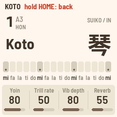 | 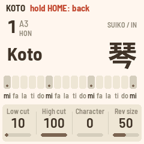 | 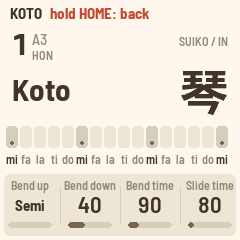 | 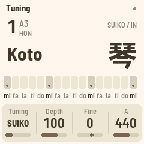 |
| Yoin (余韻, ring) · Trill rate · Vib depth · Reverb | Low cut · High cut · Character · Rev size | Bend up · Bend down · Bend time · Slide time | Tuning · Depth · Fine · A |

| Control | What it does |
|---|---|
| **White keys** | mi fa la ti do, three times, and a top mi (the ST-50's lower row). The lit keys are the tonics |
| **Black keys** | The upper row (fa♯ sol ti♭ do♯ re). With SEQ on, ornaments: vibrato, trill, damp, strong pluck |
| **SELECT** | 本数 (the key) |
| **PRESETS** | The instrument |
| **ALGORITHM** | The scale: IN, YŌ, MIN'YŌ |
| **KNOB 1–4** | The four values on the screen |
| **LFO · ARP · GLO** | Vibrato · trill · mono or poly |
| **SEL** | Tap: equal (平均律) or just (純正律) tuning. Hold: the tuning page |
| **OCT− · OCT+** | With a note held, a sprung bend down or up; with none, the octave |
| **SAVE** | Tap to save, hold 3 seconds to reset everything |
| **HOME** | Tap: the home page. Hold: back to the scene |

---

## 12. Everything at a glance

| Control | In a scene | In the koto instrument |
|---|---|---|
| PRESETS | The scene | The instrument |
| ALGORITHM | The mood | The scale |
| SELECT | Activity | The key |
| KNOB 1–4 | The page's four settings | The page's four values |
| MASTER | Volume | Volume |
| FX | Knob pages, next | The sound page |
| SEL | Knob pages, back | Tap: tuning. Hold: the tuning page |
| ENV | The lights | |
| LFO | | Vibrato |
| EDIT | | The bend page |
| GLO | Painted or pixel | Mono or poly |
| HOME | Tap: status. Hold: the koto | Tap: home page. Hold: the scene |
| SAVE | Tap: save. Hold 3 s: reset all | The same |
| ARP | | Trill |
| SEQ | Sleep timer | Black keys: upper row or ornaments |
| PLAY | A new picture | |
| REC | | |
| OCT− · OCT+ | Octave | Bend with a note held, else octave |
| White keys | Notes that fit; the scene answers | The lower row |
| Black keys | The scene's own | The upper row, or ornaments |

---

## 13. Good to know

- **Not yet on hardware.** Crawl has run in the simulator and the browser only. Levels, the look of the dark
  moods on the FM-1's panel and the processor's load are still to be measured there.
- **Nothing loops.** Every note comes from something happening in the picture, so no two minutes are the same.
- **It is quiet by design.** Turn MASTER up; the engine leaves a lot of headroom.
- **The Key page's Scale** lists ZEN-1's three Japanese scales. Leave it at Mood for Crawl's own.
- **Nature and Music pages.** In Forest Ruins, Frozen Lake and Night Sky, Echo and Warmth sit on the Nature page
  and the scene's own two settings (Fog and Wind, Snow and Wind, Clouds and Stars) on the Music page. That is how
  the firmware has it today; it may be put right.
- **Radios stay off.** Crawl never enables the FM-1's Bluetooth or Wi-Fi.

---

## 14. In the browser

The emulator at [keuller-clone.github.io/crawl/emu/](https://keuller-clone.github.io/crawl/emu/) is the firmware
itself behind a picture of the panel. Press **Switch on** first.

- **Mouse and touch.** Knobs: drag up or down, or use the scroll wheel over one. Buttons and keys: click or touch;
  drag across the white keys for a glissando. To hold a button, Shift-click or right-click it; click again to let go.
- **Keyboard.** Tab moves through every knob, button and key. Space or Enter holds one down while you hold it;
  Shift+Enter keeps a button down until you press it again. Knobs take the arrow keys, Page Up and Page Down for
  bigger steps; MASTER also Home and End.
- **Shortcuts** (the switch under the panel turns them off):

| Key | Presses |
|---|---|
| Q–I, A–K | White keys 1–8, 9–16 |
| 1–0, - | Black keys 1–11 |
| Z / X | OCT− / OCT+ |
| ↑ / ↓ | SELECT |
| Esc | HOME |
| Shift | LFO |
| / | ARP |

SAVE keeps your settings in the browser; **Factory reset** under the panel forgets them. **Mute** silences the
page without stopping it.

---

The screenshots are made by `tools/manual_shots.sh` (the script `tools/manual.zen` on the host simulator).
Crawl is unofficial: it is not affiliated with or endorsed by M-VAVE.
