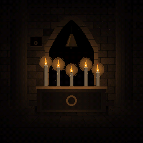
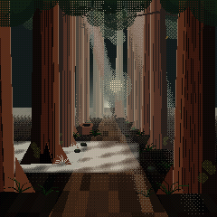
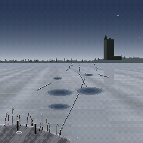
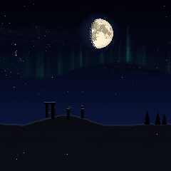

# Crawl for the M-VAVE FM-1

**Crawl** is dark generative ambient firmware for the M-VAVE FM-1. It turns the little synth into a window on four
dark places: a crypt, a redwood path among ruins, a frozen lake under a keep, a moor under the night sky. Every
movement you see is a note you hear. Switch it on and it plays by itself, slow and never quite the same; reach in
when you want to: the keys play along with the scene, and the knobs shape every part of it.

<p>




</p>

## Try it in the browser

**[keuller-clone.github.io/crawl/emu/](https://keuller-clone.github.io/crawl/emu/)**

No FM-1 needed. The page runs the firmware's own code, with sound, behind a picture of the FM-1's panel. Press
**Switch on**, then turn **PRESETS** for the scene and **ALGORITHM** for the mood. Everything under
[Controls](#controls) works there the same way, by mouse, touch or computer keyboard
([In the browser](#in-the-browser)).

## Status

Crawl is in the making (`docs/PROGRESS.md`). The four scenes, their moods and Long Night run in the host simulator
and in the browser. **It has not been flashed to an FM-1 yet**: nothing here is measured or heard on the hardware,
there is no release and no installer for it. Do not install a build from this tree on an FM-1 you care about until
a release says the install and the restore of M-VAVE's own firmware have been tested.

Crawl is unofficial: it is not affiliated with, endorsed by or supported by M-VAVE or any other trademark holder
named here. Installing custom firmware is at your own risk.

## The scenes

Turn **PRESETS** for the scene. Each has four moods and Long Night.

| Scene | What happens | Moods |
|---|---|---|
| **Crypt** | Five candles on a tomb, a bell in a niche, dust, water from the vault. A flame's gutter is a note, wax reaching a candle's foot a soft note, dust in a flame a spark and a high note; the bell is struck metal on the chord's root; a water drop is heard where it lands. Under them a choir breathes the chord | Vigil, Procession, Sealed, Embers |
| **Forest Ruins** ("Ruins" on the screen) | A path to a misty vanishing point between redwoods, ferns, shafts of light; the ruin a hollow trunk, a log, a stump and stones. A leaf landing on the path is a note; crows call from where they sit or fly; wind through a hollow is a bowed string; fog is a swell; lightning, then thunder, and the crows go up; a cone falls with a knock; an owl at night | Dawn Mist, Overgrown, Storm, Owl Moon |
| **Frozen Lake** ("Lake") | The lake from its shore, the ice running to a keep on a headland; reeds, mooring posts, a boat frozen in. Cracks run across the ice and are notes; the ice groans, pitched to the chord; the keep's bell tolls across the lake; a gust sings the reeds; meltwater drips; snow falls | Grey Dawn, Thaw, Whiteout, Black Ice |
| **Night Sky** ("Sky") | A moor under the sky, a ring of standing stones on the ridge. A star that blinks is a note where it stands; meteors are falling runs of chimes; the aurora's pulses are swells; a cloud over the moon darkens the sound; an eclipse brings a gong and a far drum. Each picture has its own moon, on the path its phase really takes | Dusk, Cold Clear, Eclipse, Deep Night |

Turn **ALGORITHM** for the mood. A mood is not a tint: each has its own sounds, its own source of notes and
something of its own to see.

- **Crypt.** Vigil: still, a low choir, few notes. Procession: a steady pace of footfalls, hooded figures crossing
  with a candle each. Sealed: one candle and a shaft of cold light, no voice, water drops in a long echo. Embers:
  three candles burning red.
- **Forest Ruins.** Dawn Mist: fog, a pale sun, one far crow. Overgrown: the forest in leaf, leaves falling thick,
  three crows, a cathedral choir. Storm: rain, the hollows singing, lightning and thunder. Owl Moon: the moon and
  stars, bats, the owl, one voice.
- **Frozen Lake.** Grey Dawn: still, light snow, the bell on its time. Thaw: pools of meltwater, drips, cracks
  thick and fast. Whiteout: everything far gone into the white, wind singing the reeds. Black Ice: night, the stars
  in the ice, groans and the whistle of far fractures.
- **Night Sky.** Dusk: the afterglow, stars coming out one by one, rooks going home. Cold Clear: every star out,
  the aurora, frost. Eclipse: the full moon into the earth's shadow and out, copper in totality. Deep Night:
  moonless, the Milky Way, a meteor shower, the owl.

**Long Night** is the first mood of every scene: one night that passes from scene to scene. It holds a scene for
half an hour, going through that scene's four moods, then fades through dark into the next (Crypt, Night Sky,
Forest Ruins, Frozen Lake; two hours round), the old scene's last notes ringing out under the new one. With
**Drift** at Off (the Key page) it stays in its scene.

Every mood remembers your tweaks across power-offs, and can be reset to how it was made.

## The sound

Nothing is a loop. Notes come from what happens on screen, in dark five-note scales (Aeolian, Dorian, Phrygian,
harmonic minor, Hungarian minor and a minor pentatonic; each mood has its own scale and key), over a breathing
drone, with a slow ebb and flow, rests, echo and reverb.

| Source or effect | What it is | Where you hear it |
|---|---|---|
| FM | A 6-operator FM engine (Dexed's msfa) | The scenes' notes: Drop, Mallet, Rin, Bell, Bamboo (the Instrument knob) |
| VOICE | A formant voice and choirs | The drone as Solo, Monks, Nuns or Cathedral (the Voices knob; Pad is the FM drone) |
| PHYS | Physical models: struck metal, bowed string, drum | Crypt's bell and footfalls, the singing hollows and reeds, thunder, the eclipse's gong and drum |
| SAMPLE | A recording played as a pitched tape loop | The lake ice's groan |
| Recordings | CC0 field recordings | Crows, the owl, ice cracking, the keep's bell |
| TAPE | Wow, saturation and hiss on the whole mix | The Tape knob |
| DELAY | A tape echo | The Echo knob |
| GRAIN | A granular cloud | Crypt's Cloud knob; some moods of the other scenes |
| Reverb | A plate | The Space knob |

VOICE, PHYS, SAMPLE, TAPE, DELAY and GRAIN are ported from [GR!MM](https://github.com/GRiMMBIENT/grimm).

## Controls

Crawl plays by itself. To start you only need **PRESETS** (the scene), **ALGORITHM** (the mood), **MASTER** (the
volume) and **PLAY** (a new picture). A welcome card shows these the first time it starts.

Crawl has two modes, and the same buttons and keys do different things in each: **a scene** (the ambient mode it
starts in) and **the koto instrument**. Hold **HOME** to switch between them; the screen shows which one you're in.

### In a scene

| Control | What it does |
|---|---|
| PRESETS | The scene: Crypt, Forest Ruins, Frozen Lake, Night Sky |
| ALGORITHM | The mood. The first is always Long Night |
| SELECT | Activity, how busy the scene is (flames, leaves, cracks or stars, and so how many notes) |
| KNOB 1–4 | The four settings on the page that's showing (below) |
| FX · SEL | FX shows the knob pages and steps through them: Scene, Volume, Nature, Music, Key. SEL goes back a page |
| GLO | Painted look or pixel art |
| ENV | The panel's lights: on, auto (out after 30 s untouched) or off |
| PLAY | A new picture: a new vault, path, shore, or moor and moon |
| HOME | Tap: the battery, the lights, the scene and the mood. Hold: the koto instrument; hold again to come back |
| SEQ | The sleep timer: each press the next time (Off, 15 m, 30 m, 1 h, 2 h, 4 h, 8 h). The picture dims over the last ten minutes, then everything fades out; any button or key wakes it |
| SAVE | Tap: save now (it also saves by itself). Hold 3 seconds: reset everything |
| OCT− · OCT+ | The notes an octave down or up. On the FM-1, both held 5 s: update mode, for installing firmware |
| MASTER | The volume |
| White keys | Notes that always fit, and the scene answers (below) |
| Black keys | Each scene's own, 1 to 11 from the left (below) |

The keys in each scene:

| Scene | White keys | Black keys |
|---|---|---|
| Crypt | The candle nearest your note flares | 1–5 snuff or light a candle, 6–10 ring the bell; the top key sends a draught |
| Forest Ruins | A leaf is let go above your note | 1–4 a crow each, 5–7 a hollow sings, then a gust, a fog bank and a falling cone; the top key is lightning |
| Frozen Lake | A crack runs where your note lands | 1–3 a crack near, middle or far, 4 a groan, 5–7 the keep's bell (one to three strokes), then a gust, a drip and a flurry; the top key is the ice giving |
| Night Sky | The nearest star flares | 1–2 a meteor west or east, 3 a fireball, 4 a cloud across the moon, 5 an aurora pulse, 6 the gong, 7 the drum, 8 an eclipse begins, 9 another moon, 10 the owl; the top key is a burst of meteors |

The knob pages, KNOB 1 to 4 on each:

| Page | Crypt | Forest Ruins | Frozen Lake | Night Sky |
|---|---|---|---|---|
| Scene | Mood, Activity, Instrument, Space | the same | the same | the same |
| Volume | Notes, Choir, Air, Bell | Notes, Drone, Air, Harp | Notes, Drone, Air, Bell | Notes, Drone, Air, Chimes |
| Nature | Tolls, Tape, Voices, Drips | Voices, Crows, Fog, Wind | Voices, Cracks, Snow, Wind | Voices, Meteors, Clouds, Stars |
| Music | Echo, Warmth, Cloud, Tide | Echo, Warmth, Tape, Tide | Echo, Warmth, Tape, Tide | Echo, Warmth, Tape, Tide |
| Key | Key, Scale, Chord, Drift | the same | the same | the same |

Space is the reverb, Warmth bright to mellow, Tide how much the music slowly swells and fades, Voices the choir
(Pad, Solo, Monks, Nuns, Cathedral), Drift how the key moves at each dawn (Off also holds Long Night in its scene).
The Key page's Scale still lists ZEN-1's three scales and, when set, holds one of them over the mood's own.

### In the koto instrument (hold HOME)

FuMi-1's ST-50-style koto instrument is kept from ZEN-1 as a mode, with its Japanese names.

| Control | What it does |
|---|---|
| White keys | mi fa la ti do, three times, and a top mi (the ST-50's lower row). The lit keys are the tonics |
| Black keys | The upper row (fa♯ sol ti♭ do♯ re). With SEQ on, ornaments: vibrato, trill, damp, strong pluck |
| SELECT · PRESETS · ALGORITHM | 本数 (the key) · the instrument · the scale (IN, YŌ, MIN'YŌ) |
| KNOB 1–4 | The four values on the screen. HOME page: 余韻 (ring), trill rate, vibrato depth, reverb. FX: the sound page. EDIT: the bend page |
| LFO · ARP · GLO | Vibrato · trill · mono or poly |
| SEL | Tap: equal (平均律) or just (純正律) tuning. Hold: the tuning page |
| OCT− · OCT+ | With a note held, a sprung bend down or up; with none, the octave |
| SAVE · HOME | SAVE: tap to save, hold 3 seconds to reset everything. HOME held: back to the scene |

### In the browser

- **Mouse and touch.** Knobs: drag up or down, or use the scroll wheel over one. Buttons and keys: click or touch;
  drag across the white keys for a glissando. To hold a button, Shift-click or right-click it; click again to let go.
- **Keyboard.** Tab moves through every knob, button and key. Space or Enter holds one down while you hold it;
  Shift+Enter keeps a button down until you press it again. Knobs take the arrow keys, Page Up and Page Down for
  bigger steps; MASTER also Home and End.
- **Shortcuts** (the switch under the panel turns them off):

| Key | Presses |
|---|---|
| Q–I, A–K | White keys 1–8, 9–16 |
| 1–0, - | Black keys 1–11 |
| Z / X | OCT− / OCT+ |
| ↑ / ↓ | SELECT |
| Esc | HOME |
| Shift | LFO |
| / | ARP |

SAVE keeps your settings in the browser, as the FM-1 keeps them in its memory; **Factory reset** under the panel
forgets them.

## Building and testing

See [BUILDING.md](BUILDING.md) and [docs/dev-environment.md](docs/dev-environment.md).

From Windows (PowerShell, Docker Desktop running), each command runs the matching shell script inside the build
container, `Dockerfile`:

```
.\tests\run_tests.ps1                  # host tests, the simulator scenarios, the browser build, the tools
.\build.ps1                            # build/crawl.fwsc (JieLi toolchain)
.\web\emu\build.ps1                    # the browser emulator, and the audition bench for developers (Emscripten)
.\host\build_host.ps1                  # the host simulator, build/host/crawl_host
tools\docker_run.ps1 build/host/crawl_host SCRIPT OUTDIR   # the whole app on a computer, from a script (tests/scenarios/*.zen)
```

The emulator on your own machine, after `.\web\emu\build.ps1`:

```
python -m http.server 8765 --bind 127.0.0.1 --directory build\emu
```

then `http://127.0.0.1:8765/`. The public page is pushed with `tools/publish_pages.sh --emu LABEL` (Git Bash).

Inside the container, or on Linux or macOS with the tools installed (`docs/dev-environment.md`), the shell scripts
run directly: `tests/run_tests.sh`, `./build.sh`, `web/emu/build.sh`, `host/build_host.sh`.

The host simulator runs the same app code as the FM-1, writing audio and screenshots, so nearly everything can
be developed and tested without the hardware. It and its scenario scripts still carry ZEN-1's three scenes
(Sakura, Koi, Hotaru) beside Crawl's four; the FM-1 image and the browser build have Crawl's four only.

## Layout

| Path | What |
|---|---|
| `firmware/src/app/` | The app: the scenes (`scene_*.c`), the conductor (the music), the 8-bit renderer, the panel and UI, saved settings |
| `firmware/src/dsp/` | Sound: the FM6 core and FuMi-1's instrument, GR!MM's voices and effects, the nature beds and recordings, reverb, tuning |
| `firmware/hal/`, `firmware/loader/`, `firmware/src/*.c` | The platform (Felucca's, via FoMni), kept byte-for-byte; `tools/guard_platform.sh` checks it |
| `host/`, `web/emu/` | The host simulator and the browser emulator |
| `web/site/`, `web/zen_installer.html` | ZEN-1's landing page, guide and web installer, not yet rewritten for Crawl and not published |
| `web/bench/` | FuMi-1's audition bench for voicing FM patches (a developer's tool) |
| `tools/` | Build, install, rescue, and the generators for patches, samples, fonts and the moon |
| `assets/` | Fonts, the CC0 recordings and samples and the NASA moon map, each with its source |
| `tests/` | Host unit tests and the simulator scenarios |
| `docs/` | `PROGRESS.md` (state), `DECISIONS.md` (why), `BUDGET.md` (measured flash, RAM and CPU) |

Comments that cite `docs/research/` refer to FuMi-1's research notes, in
[cartesive/fumi-1](https://github.com/cartesive/fumi-1/tree/main/docs/research).

## Credits

Crawl is a fork of [ZEN-1](https://github.com/aceyprime/zen-1) by AceyPrime: its scene and event engine, conductor,
renderer, simulator, emulator and tools. Its VOICE, PHYS and SAMPLE sources and TAPE, DELAY and GRAIN effects are
ported from [GR!MM](https://github.com/GRiMMBIENT/grimm) v2.0.2 by GRiMMBIENT.

ZEN-1 is built on [FuMi-1](https://github.com/cartesive/fumi-1) by cartesive, whose instrument it keeps as a mode;
on [FoMni](https://github.com/charlesvestal/fm1-fomni) by Charles Vestal; and on the platform of
[Felucca](https://github.com/hugelton/Felucca) by Leo Kuroshita (Hügelton Instruments), by way of
[X0X](https://github.com/charlesvestal/fm1-x0x). The 6-operator FM core is Felucca's C port of msfa (Dexed, Google
and Pascal Gauthier, Apache-2.0). The browser emulator idea comes from Groove OS.

PHYS's models are Felucca's fixed-point ports of [DaisySP](https://github.com/electro-smith/DaisySP) (Electrosmith
and Emilie Gillet, MIT) and of the sympathetic strings of Emilie Gillet's Rings (MIT). The choirs' wavetables are
made from [VocalSet: A Singing Voice Dataset](https://doi.org/10.5281/zenodo.1442513) by Julia Wilkins, Prem
Seetharaman, Alison Wahl and Bryan Pardo (Northwestern University, 2018), CC BY 4.0, changed: single cycles
measured from its singers' long tones ([LICENSING.md](LICENSING.md)).

Ideas, not code, came to ZEN-1 from Charles Vestal's [AMB-1](https://github.com/charlesvestal/fm1-amb) (the
breathing drone, rests, loops and the slow arc), Leo Kuroshita's [Avonlea](https://github.com/kurogedelic/avonlea)
(moods), keremimo's [Melodee](https://github.com/keremimo/melodee) (sending the screen only what changed), ambalek's
[fall](https://github.com/ambalek/fall) (echoes, motifs, a population of falling things) and Dillbo's
[KoiBoi2](https://github.com/Dillbo/KoiBoi2) (food eaten as notes, the pond's memory).

The recordings and samples are CC0, from Freesound ([assets/sounds/README.md](assets/sounds/README.md),
[assets/SAMPLES.md](assets/SAMPLES.md)); the moon is from NASA's Scientific Visualization Studio CGI Moon Kit,
public domain ([assets/images/README.md](assets/images/README.md)).

## License

GPL-3.0-only; see [LICENSING.md](LICENSING.md). M-VAVE and FM-1 are trademarks of their owners; Suiko and ST-50 are
names of Suikohsha. Crawl is independent firmware, not affiliated with or endorsed by any of them. It never enables
the hardware's Bluetooth or Wi-Fi radio.
